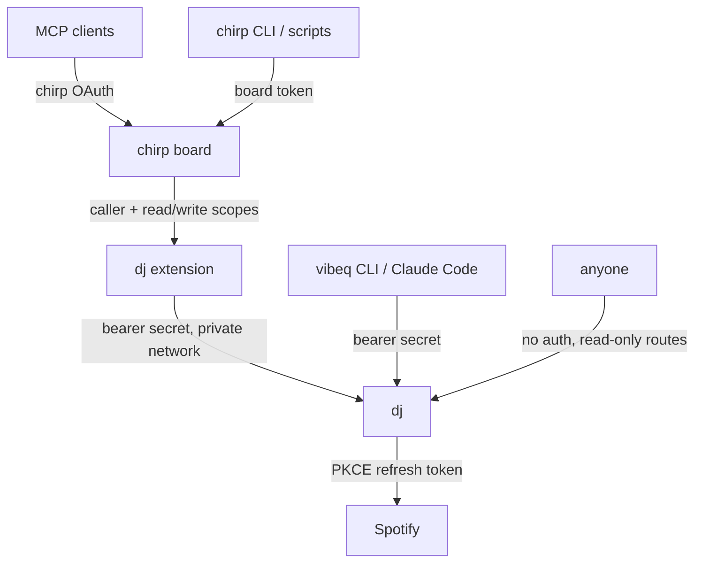

# dj

dj lets AI agents DJ on your real Spotify account. You talk to an agent ("ease me from shoegaze into trip-hop over the next half hour", "more like this", "skip, too sad"). The agent picks the tracks, and dj resolves, queues and plays them, so the music never stops.

The daemon is called **vibeq** (`package.json`, the CLI and `~/.config/vibeq`). It has these surfaces:

- **MCP** (Streamable HTTP) at `/mcp`, for Claude Code, Claude Desktop and other MCP clients.
- **An HTTP tool API** at `POST /api/tools/<name>`, for proxies such as the chirp extension.
- **A CLI** (`vibeq call <tool> '<json>'`) for agents that run shell commands, against a local or deployed daemon.
- **A public live view** at `/`, showing what's playing, what's planned and what just played.
- **A background feeder** that keeps Spotify's queue in sync with the agent's plan.

There are two ways to run it:

| | Who can drive it | Setup |
|---|---|---|
| **[Standalone](#run-standalone)** | Agents on your machine, or anyone holding dj's secret | [Local](#local) in about 5 minutes, or [deployed](#deployed-railway) on Railway |
| **[As a chirp extension](#run-as-a-chirp-extension)** | Every agent on your [chirp](https://github.com/CryogenicPlanet/chirp) board, with chirp's OAuth and scopes | Deploy dj next to the board, then install [`chirp/`](chirp/README.md) |

## Why not Spotify DJ or the Spotify MCP?

**Spotify's queue can't be edited over the Web API.** You can add tracks and read the queue, but you can't remove, reorder or clear it. So a naive agent that queues 15 songs can't change course when you say "nah, switch it up."

dj keeps its own editable **plan** and keeps **exactly one plan track locked into Spotify's queue**, so skips, crossfade and Automix all land on the plan. The agent can add, insert next, remove, move or replace the rest of the plan whenever it wants.

The track already handed to Spotify ("locked in") is where a new direction starts. If the listener wants it gone, dj skips it automatically the moment it starts.

On top of that:

- **Batch fuzzy resolution.** The agent sends `[{title, artist, note}]` in one call. dj searches Spotify, scores the candidates (penalising karaoke, covers, live and remix versions you didn't ask for) and reports misses and fuzzy matches so the agent can fix them.
- **Session memory.** It dedupes against what has already played, keeps history with vibe labels, and stores feedback ("love", "hate", "too much autotune") that persists across sessions.
- **Your real taste, not just Spotify's top lists.** Its sources:
  - curated profile notes (markdown files);
  - live [stats.fm](https://stats.fm) stats (top genres, top artists with genres, recent streams);
  - a multi-year streaming-history export (play counts and early-skip rates);
  - tier playlists (`L1 — …`, `L2 — …`, `L3 — …`).

  Every track an agent sees says how you know it, or that it's new to you.
- **Similarity data without Spotify's removed endpoints.** Spotify killed recommendations, related-artists, audio-features and artist top-tracks for development-mode apps. Optional Last.fm tools fill the gap: similar tracks and artists, tag charts, and tags.
- **DJ playbook.** The server instructions (`/init`) teach agents to:
  - bridge genres in 2–5 song transitions;
  - build from the locked-in track;
  - mix familiar tracks with discovery;
  - react to events instead of polling.

## How the feeder works

```
agent ──queue_songs──▶  plan [t4 t5 t6 t7 …]   (editable: add / move / remove / replace)
                              │  as soon as the previous one starts
                              ▼
                     Spotify queue [t4]          (always exactly one "locked-in" track)
                              │  track starts
                              ▼
            history (+ vibe label) ── if t4 was cancelled → auto-skip
```

It polls `GET /me/player` adaptively: at most every 15 seconds, and right after each track boundary so history stays accurate and cancelled tracks get skipped fast. Tool calls wake it immediately. State is saved to `session.json`, so restarts keep your plan.

Known limits:

- `replace` keeps the locked-in track, because new directions build from it. Only an explicit `cancel_locked_in` or `edit_plan` removal skips it, and that costs about a 1-second blip.
- When the plan runs dry, Spotify's autoplay takes over. That's deliberate: dj never picks tracks itself. The agent steers.
- Development-mode Spotify apps allow 5 users and cap search at 10 results per request. Both are fine for personal use.

## Run standalone

### Local

Requirements: [bun](https://bun.sh) and **Spotify Premium**. Premium is required for playback control and for development-mode apps.

```bash
bun install
bun link                 # puts `vibeq` on your PATH (or use `bun src/main.ts …`)
vibeq setup              # prints these steps with your exact redirect URI
```

1. **Create a Spotify app** at <https://developer.spotify.com/dashboard> → *Create app*.
   - Redirect URI: `http://127.0.0.1:8765/callback`
   - API: *Web API*

   Then copy the Client ID:

   ```bash
   vibeq config set spotify-client-id <CLIENT_ID>
   ```

2. **Optional, recommended: get a Last.fm API key** at <https://www.last.fm/api/account/create> (free, instant):

   ```bash
   vibeq config set lastfm-api-key <KEY>
   ```

3. **Log in** (OAuth PKCE, so there's no client secret):

   ```bash
   vibeq login
   ```

4. **Optional taste sources:**

   ```bash
   vibeq config set statsfm-user <stats.fm id>                 # public stats.fm profile, no auth
   vibeq config set profile-files ~/notes/taste.md,...         # markdown taste notes, re-read on every call
   vibeq config set history-dir <dir with track_metrics.csv>   # streaming-history analysis
   vibeq config set port 8766                                  # if 8765 is taken (update the redirect URI too)
   ```

5. **Run the daemon.** Use `vibeq serve` in a terminal, or on macOS run `vibeq install-service` to keep it running in the background at login through launchd. Logs go to `~/.config/vibeq/daemon.log`.

6. **Connect your agent.** For Claude Code:

   ```bash
   claude mcp add --transport http --scope user vibeq http://127.0.0.1:8765/mcp
   ```

Check everything with `vibeq status`. Locally, with no secret configured and bound to `127.0.0.1`, every route is open to your machine.

### Deployed (Railway)

dj runs as a single service built from the `Dockerfile`, with a volume mounted at `/data`. Railway is the tested host; any container host with a persistent volume works.

```bash
railway add --service dj        # inside a linked project
railway volume add --mount-path /data
railway up --ci --service dj
railway domain dj.example.com --service dj   # optional public URL; add the DNS records it prints
```

Set these on the service:

| Env var | Value |
|---|---|
| `VIBEQ_PUBLIC_URL` | The public origin, e.g. `https://dj.example.com`. The OAuth redirect is `<origin>/callback`; add it to the Spotify app |
| `VIBEQ_PROXY_SECRET` | A random secret (`openssl rand -hex 32`). Callers send it as a bearer token |
| `VIBEQ_OWNER_SPOTIFY_ID` | Only this Spotify account may link itself at `/login` |
| `SPOTIFY_CLIENT_ID` | The Spotify app's client ID (PKCE, no secret) |
| `STATSFM_USER` | Optional stats.fm user id |
| `LASTFM_API_KEY` | Optional |
| `VIBEQ_PROFILE_FILES` | e.g. `/data/dj-profile.md,/data/profile.md` |
| `VIBEQ_HISTORY_DIR` | e.g. `/data/history` (holds `track_metrics.csv`) |
| `VIBEQ_HOST` | Set to `::` to listen on IPv6 too, such as Railway's private network. The image defaults to `0.0.0.0` |

Change variables with `railway redeploy`, not `railway restart`. A restart keeps the old environment.

Routes:

- **Public:**
  - `/` (live view)
  - `/api/now`
  - `/init` (the agent guide)
  - `GET /api/tools` (catalog with schemas)
  - `/health`
  - `/login` → `/callback` (owner only)
- **Bearer-gated:** `/mcp`, `POST /api/tools/:name`, `POST /api/admin/import/:file` and `POST /api/admin/restart`.

dj needs a Spotify login on the server. Either open `<origin>/login` as the owner, or move a local install's state over. Use one of these two ways to copy the files:

```bash
# Over HTTP:
for f in dj-profile.md profile.md feedback.json session.json tracks.db token.json; do
  curl -X POST "$DJ/api/admin/import/$f" -H "Authorization: Bearer $SECRET" --data-binary @"$HOME/.config/vibeq/$f"
done
curl -X POST "$DJ/api/admin/import/track_metrics.csv" -H "Authorization: Bearer $SECRET" --data-binary @<history dir>/track_metrics.csv
curl -X POST "$DJ/api/admin/restart" -H "Authorization: Bearer $SECRET"

# Or straight onto the Railway volume (the service must be running):
railway volume files --volume dj-volume upload ~/.config/vibeq/token.json /token.json
railway volume files --volume dj-volume upload <snapshot of tracks.db> /tracks.db.import   # swapped in at startup
railway restart --service dj
```

Then stop the local daemon (`vibeq uninstall-service`). Spotify rotates refresh tokens, so two daemons can't share one login.

**Drive a deployed dj from your machine.** Point the CLI at it:

```bash
vibeq config set remote-url https://dj.example.com
vibeq config set remote-secret <VIBEQ_PROXY_SECRET>
vibeq now
```

Then add it to Claude Code:

```bash
claude mcp add --transport http --scope user dj https://dj.example.com/mcp --header "Authorization: Bearer <VIBEQ_PROXY_SECRET>"
```

## Run as a chirp extension

Use this to give every agent on a chirp board dj access, with chirp's own OAuth, passkey consent and read/write scopes. No agent then needs dj's secret.

1. Deploy dj as above, as a service **in the chirp board's Railway project**, with `VIBEQ_HOST=::`. The board reaches it at `http://dj.railway.internal:8080`, so a public domain is optional.
2. Install the extension in [`chirp/`](chirp/README.md) on the board. It adds `dj_guide` and `dj` to the board's MCP, plus `GET /api/dj` and `POST /api/dj/:tool` to its API.
3. Tell the board where dj is: `PUT /api/dj/settings {url, secret}`, or `chirp.ts dj-config <url>` with the secret on stdin.

[`chirp/README.md`](chirp/README.md) has the full steps, the error codes and the gotchas.

## Auth



- **dj accepts one credential:** `VIBEQ_PROXY_SECRET`, compared in constant time.
- **Chirp forwards the caller.** It sends `x-chirp-caller` and `x-chirp-scopes` with each call. dj logs the caller and refuses tools that change things (`queue_songs`, `edit_plan`, `playback`, …) when the scopes lack `write`.
- **Only the owner can log in.** `VIBEQ_OWNER_SPOTIFY_ID` stops anyone else's Spotify account from linking itself at `/login`.

## Tools

| Tool | What it does |
|---|---|
| `now_playing` | Playback, the locked-in track, the plan (with keys), recent history, hints ("plan running low") |
| `queue_songs` | Batch resolve and add. `position`: `end` / `next` / `replace`. Takes a `vibe` label. Auto-starts if idle |
| `edit_plan` | Remove by key, move, clear, reset history |
| `play_now` | Interrupt with one song; the plan continues afterwards |
| `playback` | pause / resume / skip / previous / volume |
| `devices` | List Spotify Connect devices and transfer playback |
| `search_tracks` | Raw Spotify search (supports `track:` / `artist:` / `year:` / `genre:` filters) |
| `my_taste` | Profile notes, top artists (with genres), genres right now, recent favourites, saved feedback |
| `liked_songs` | Recent or random sample of Liked Songs |
| `feedback` | Persist love / like / meh / dislike / hate, with an optional note; can save the track to Liked Songs |
| `save_playlist` | Save the session's set as a playlist |
| `listening_stats` | Live stats.fm top tracks / artists (with genres) / genres / recent streams |
| `wait_for_event` | Block until `track_started` / `skipped` / `plan_low` / `plan_empty` / `paused` / `resumed`, so agents react instead of polling |
| `annotate_tracks` | Write lane, energy (1-10), tags and notes into the persistent track cache |
| `find_tracks` | Query the cache by lane, tag, BPM range, energy, tier (L1/L2/L3) or text |
| `transitions` | Log of A → B pairs that actually played, and whether B was skipped |
| `playlists` | List the listener's playlists, or read one in order (curated sets show approved transitions) |
| `listening_history` | Multi-year history: recent_favorites, all_time, rediscover, often_skipped, artist |
| `update_profile` | Append to or replace the listener's notes file |
| `similar_tracks`, `similar_artists`, `tag_tracks`, `tags`, `artist_top_tracks` | Last.fm similarity and tags (need an API key) |

From a shell:

```bash
vibeq tools
vibeq now
vibeq call queue_songs '{"vibe":"late-night trip-hop","songs":[{"title":"Teardrop","artist":"Massive Attack"},{"title":"Roads","artist":"Portishead"}]}'
vibeq call edit_plan '{"remove":["t2"]}'
```

## Track cache and events

dj builds a personal music graph in `tracks.db` (SQLite):

- **Facts per track.**
  - BPM and loudness come from Deezer, looked up by ISRC in the background.
  - Tier comes from playlists named `L1 — …`, `L2 — …` and `L3 — …`, refreshed every 6 hours.
  - Liked status is checked daily.
  - Lane, energy, tags and notes are written by agents through `annotate_tracks`.
- **Transitions.** Every A → B that played, and whether B was skipped. A skip means the listener moved on before 70% of the track with more than 45 seconds left, so Automix's early fades don't count.

Every track an agent sees carries `you` (for example "L1 current rotation · liked · 48 plays, 44 in last 90d", or "new to you"), plus `bpm` and `vibe_tags`.

Events are available through the `wait_for_event` tool, or from a shell:

```bash
vibeq wait --types track_started,skipped,plan_low   # blocks, prints JSON, exits; reconnects if the daemon restarts
```

## Development

```bash
bun run check        # tsgo typecheck + oxlint + bun test
VIBEQ_HOME=/tmp/vq VIBEQ_PORT=8799 bun src/main.ts serve   # isolated instance
```

The stack is [Effect 4](https://effect.website) throughout:

- `effect/ai` McpServer and Toolkit for MCP;
- `effect/http` for the server and client;
- `effect/cli` for the CLI;
- Schema at every boundary;
- services and layers for dependency injection.

The pure plan logic lives in `src/Plan.ts` and is unit-tested. The chirp extension in `chirp/ext/` is written against chirp's extension API and typechecked on the board when it reloads.
