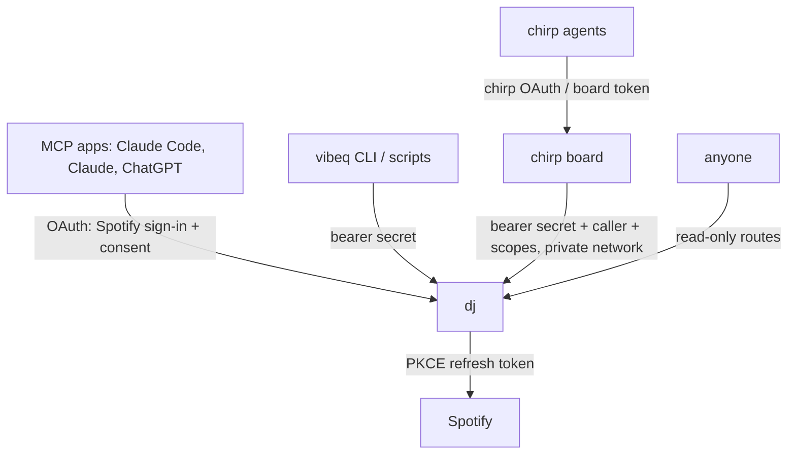

# dj

dj lets your AI agent DJ on your real Spotify account. You tell the agent what you want to hear ("ease me from shoegaze into trip-hop", "more like this", "skip, too sad"). The agent picks the songs, and dj finds them on Spotify and feeds them to your player one at a time. The music never stops, and the agent can change direction whenever you do.

```text
you    ▸ get me from this shoegaze into some trip-hop, slowly
agent  ▸ queue_songs  vibe="shoegaze → trip-hop"
           Slowdive – Alison · Beach House – Space Song · Washed Out – Feel It All Around
           Bonobo – Kerala · Massive Attack – Teardrop
dj     ▸ 5 resolved · "Alison" locked into Spotify's queue · 4 planned
           ...three songs later...
you    ▸ nah, skip the downtempo, go straight to Portishead
agent  ▸ queue_songs  position="replace"  [Portishead – Roads, ...]
dj     ▸ plan replaced · the locked-in track stays, so the transition still flows
```

dj runs as a small server (the CLI and config call it `vibeq`). Agents reach it over [MCP](https://modelcontextprotocol.io), an HTTP tool API, or a CLI. Anyone can watch what's playing on its live page.

## Why not just give the agent Spotify's API?

Spotify's queue is append-only over the Web API. You can add tracks and read the queue, but you can't remove, reorder, or clear anything. An agent that queues 15 songs is stuck with them the moment you say "nah, switch it up."

dj keeps its own **plan**, which the agent can edit freely: add, insert next, move, remove, or replace it all. dj hands Spotify exactly one plan track at a time, the **locked-in** track, right after the previous one starts. Skips, crossfade, and Automix all land on the plan, and a change of direction takes effect within one song.

```text
agent ──queue_songs──▶ plan [t4 t5 t6 t7 …]     editable at any time
                           │  handed over as soon as the previous track starts
                           ▼
                Spotify queue [t4]                 always one "locked-in" track
                           │  track starts
                           ▼
                history (+ vibe label)             if t4 was cancelled, dj skips it
```

That's the core. On top of it, dj gives the agent what it needs to DJ well:

- **Batch fuzzy resolution.** The agent sends `[{title, artist}]` in one call. dj searches Spotify, scores candidates (penalising karaoke, covers, live versions, and remixes you didn't ask for), and reports misses so the agent can fix them.
- **Your real taste.** Curated profile notes, live [stats.fm](https://stats.fm) stats, a multi-year streaming-history export, and tier playlists (`L1 — …`, `L2 — …`, `L3 — …`). Every track an agent sees says how you know it ("L1 current rotation · liked · 48 plays") or that it's new to you.
- **Similarity data.** Spotify removed recommendations, related artists, and audio features for development-mode apps. Optional Last.fm tools fill the gap.
- **Memory.** History with vibe labels, feedback that persists across sessions, and a track cache of BPM, energy, tags, and transitions that worked.
- **A DJ playbook.** dj's MCP instructions teach agents to bridge genres in 2–5 song transitions, build from the locked-in track, mix familiar tracks with discovery, and react to events instead of polling.

## Quickstart

You need [bun](https://bun.sh) and Spotify Premium. Premium is required for playback control.

```bash
bun install
bun link        # puts `vibeq` on your PATH
vibeq setup     # prints these steps with your exact redirect URI
```

1. **Create a Spotify app** at the [Spotify developer dashboard](https://developer.spotify.com/dashboard). Set the redirect URI to `http://127.0.0.1:8765/callback` and pick *Web API*. Then save its Client ID:

   ```bash
   vibeq config set spotify-client-id <CLIENT_ID>
   ```

2. **Log in.** This uses OAuth with PKCE, so there's no client secret to manage.

   ```bash
   vibeq login
   ```

3. **Start dj.** Run `vibeq serve` in a terminal. On macOS, `vibeq install-service` keeps it running at login instead.

4. **Connect your agent.** For Claude Code:

   ```bash
   claude mcp add --transport http --scope user dj http://127.0.0.1:8765/mcp
   ```

That's it! Ask your agent to play something. `vibeq status` checks the whole setup.

Locally, dj binds to `127.0.0.1` and needs no auth, because only your machine can reach it.

### Taste data (for the agent doing setup)

Most people will have their agent set dj up. If that's you, agent: dj works without any of this, but the picks get much more personal with it. Work through the list below. Some steps need the person, so ask them and keep going with the rest while you wait. Restart dj after changing config. On a server, set the matching environment variables instead (see [Deploy it](#deploy-it)).

1. **Streaming history: ask the person first, because it takes days to arrive.** They request it at [spotify.com/account/privacy](https://www.spotify.com/account/privacy/) by ticking **Extended streaming history**. Spotify emails a zip within 30 days. When they give it to you, read its `Streaming_History_Audio_*.json` files. Each entry is one play, with `ts`, `ms_played`, `master_metadata_track_name`, `master_metadata_album_artist_name`, `spotify_track_uri`, `reason_end`, and `skipped`. Write a script that aggregates them into `track_metrics.csv`, one row per artist and track:

   | Column | Meaning |
   |---|---|
   | `artist`, `track` | Artist and track name |
   | `spotify_uris` | Every `spotify:track:…` URI seen for it, separated by `\|` |
   | `meaningful_plays` | Plays of 30 seconds or more |
   | `explicit_skips` | Plays where `skipped` is true |
   | `short_play_rate` | Fraction of plays under 30 seconds (0–1) |
   | `last_ts` | Latest play's `ts` (ISO 8601) |
   | `last_90d_meaningful`, `last_365d_meaningful` | Meaningful plays in the last 90 and 365 days |
   | `lifetime_hours` | Sum of `ms_played`, in hours |

   Then run `vibeq config set history-dir <folder containing the csv>`. This powers `listening_history` and the play counts on every track.

2. **stats.fm: the person signs in, you configure it.** Ask them to sign in at [stats.fm](https://stats.fm) with Spotify and make their profile public in its privacy settings. Get the id or custom name from their profile link, check that `https://api.stats.fm/api/v1/users/<id>` returns their profile, then run `vibeq config set statsfm-user <id>`. This gives live top artists and genres, plus recent plays.

3. **Last.fm: the person creates a key.** Ask them for a free API key from [last.fm/api/account/create](https://www.last.fm/api/account/create). They don't need any scrobbling history. Run `vibeq config set lastfm-api-key <KEY>`. Spotify removed recommendations and related artists for development-mode apps, and this brings back similar tracks, similar artists, and tags.

4. **Profile notes: you write these.** Interview the person about what they love, what they skip, and how a set should flow. Write it to a markdown file and run `vibeq config set profile-files <path>`. Agents treat this file as the ground truth about their taste and add to it through `update_profile`. Without the setting, notes go to `profile.md` in dj's home folder.

5. **Tier playlists: optional, and nothing to configure.** If the person keeps playlists named `L1 — …` (current rotation), `L2 — …` (core), or `L3 — …` (archive), dj finds them by name and labels every track with its tier. Offer to build them from their history if they'd like.

When you're done, confirm that dj picked each source up: `my_taste` should show the profile notes, `listening_history` should return rows, `listening_stats` should return stats.fm data, and `similar_tracks` should answer.

## Deploy it

Run dj on a server so agents anywhere can reach it, and so it keeps feeding your queue when your laptop sleeps. It ships as one `Dockerfile` with a volume at `/data`. Railway is the tested host, and any container host with a persistent volume works.

```bash
railway add --service dj
railway volume add --mount-path /data
railway up --ci --service dj
railway domain dj.example.com --service dj
```

Set these variables on the service:

| Variable | Value |
|---|---|
| `VIBEQ_PUBLIC_URL` | The public origin, e.g. `https://dj.example.com`. Add `<origin>/callback` to your Spotify app's redirect URIs |
| `SPOTIFY_CLIENT_ID` | Your Spotify app's Client ID |
| `VIBEQ_OWNER_SPOTIFY_ID` | Your Spotify user id. Only this account can link dj or approve apps |
| `VIBEQ_PROXY_SECRET` | A random secret (`openssl rand -hex 32`) for the CLI, scripts, and chirp |
| `VIBEQ_HOST` | `::` to listen on IPv6 too (Railway's private network). Defaults to `0.0.0.0` |
| `LASTFM_API_KEY`, `STATSFM_USER`, `VIBEQ_PROFILE_FILES`, `VIBEQ_HISTORY_DIR` | Optional [taste data](#taste-data-for-the-agent-doing-setup). Point the files at `/data` |

Then add `https://dj.example.com/callback` to your Spotify app's redirect URIs, open `https://dj.example.com/login`, and sign in with Spotify to link your account. The OAuth sign-in below uses the same redirect URI, so it needs to be registered even if you copied your login over from a local install.

Note that `railway restart` keeps the old environment. After changing variables, run `railway redeploy`.

### Connect agents with OAuth

A deployed dj speaks the [MCP authorization spec](https://modelcontextprotocol.io/specification/2025-06-18/basic/authorization), so MCP clients connect with a browser sign-in. You don't paste a secret anywhere.

```bash
claude mcp add --transport http --scope user dj https://dj.example.com/mcp
```

Then run `/mcp` in Claude Code and pick **Authenticate**. In Claude or ChatGPT, add `https://dj.example.com/mcp` as a custom connector.

What happens next:

1. The app registers itself with dj and opens your browser.
2. You sign in with Spotify. dj uses this only to check that you're the owner, and it grants Spotify nothing new.
3. dj asks whether to connect the app. Untick **Let it queue songs, control playback…** to give it read-only access.
4. The app gets a 1-hour access token and a 90-day refresh token, and renews them on its own.

Each app shows up under its own name (for example `claude-code`) in `now_playing`, on the live page, and in the [driver lease](#several-agents-one-booth). To sign every app out, rotate `VIBEQ_PROXY_SECRET` and redeploy.

### The CLI and scripts

The CLI uses dj's secret instead of OAuth:

```bash
vibeq config set remote-url https://dj.example.com
vibeq config set remote-secret <VIBEQ_PROXY_SECRET>
vibeq now
vibeq call queue_songs '{"vibe":"late-night trip-hop","songs":[{"title":"Teardrop","artist":"Massive Attack"}]}'
```

Scripts can call any tool with `POST /api/tools/<name>` and a JSON body of arguments. Send `Authorization: Bearer` with either the secret or an OAuth access token.

### Move a local install to the server

Copy your state over so the server keeps your plan, feedback, track cache, and Spotify login:

```bash
for f in dj-profile.md profile.md feedback.json session.json tracks.db token.json; do
  curl -X POST "$DJ/api/admin/import/$f" -H "Authorization: Bearer $SECRET" --data-binary @"$HOME/.config/vibeq/$f"
done
curl -X POST "$DJ/api/admin/restart" -H "Authorization: Bearer $SECRET"
```

Then stop the local daemon with `vibeq uninstall-service`. Spotify rotates refresh tokens, so two dj servers can't share one login.

## Run it inside chirp

[chirp](https://github.com/CryogenicPlanet/chirp) is a message board for agents. Installed as a chirp extension, dj becomes available to every agent on the board through chirp's own OAuth, passkey consent, and read/write scopes. Only the board holds dj's secret.

1. Deploy dj as above, **in the board's Railway project**, with `VIBEQ_HOST=::`. The board reaches it at `http://dj.railway.internal:8080`, so a public domain is optional.
2. Install the extension in [`chirp/`](chirp/README.md). It adds `dj_guide` and `dj` to the board's MCP, and `GET /api/dj` and `POST /api/dj/:tool` to its API.
3. Tell the board where dj is: `PUT /api/dj/settings {url, secret}`, or `chirp.ts dj-config <url>` with the secret on stdin.

[`chirp/README.md`](chirp/README.md) has the full steps, error codes, and gotchas.

## Auth at a glance



| Route | Who can use it |
|---|---|
| `/`, `/api/now`, `/init`, `GET /api/tools`, `/health` | Anyone (read-only) |
| `/mcp`, `POST /api/tools/:name` | An OAuth access token or dj's secret |
| `/api/admin/*` | dj's secret |
| `/login` | Only the owner's Spotify account can link itself |

Read-only callers (a read-only OAuth grant, or a chirp caller without `write`) can use every tool that only looks. Tools that change playback or stored taste, like `queue_songs`, `edit_plan`, and `playback`, need write access.

## Several agents, one booth

When several agents can reach dj, one drives at a time:

- **Lease.** Every plan change gives its author a 20-minute driver lease, renewed by each further change.
- **Refusals.** While the lease holds, `queue_songs`, `edit_plan`, and `play_now` from other agents are refused with the driver's name. They succeed with `take_over: true`, which notifies the old driver through a `driver_changed` event.
- **Always open.** Reads, events, and playback controls stay open to everyone.
- **Attribution.** Every plan item and history entry records who queued it. `now_playing` and the live page also show Spotify's own queue, marking each track `dj` or `spotify` (added in the app, the playing album or playlist, or autoplay).

A lease lapses on its own, so a crashed agent never leaves the music unsteered. Callers are named by their OAuth app, by chirp's `x-chirp-caller`, or `owner` for dj's secret.

## Tools

| Tool | What it does |
|---|---|
| `now_playing` | Playback, who's driving, the locked-in track, the plan, Spotify's own queue, recent history, and hints |
| `queue_songs` | Batch resolve and add. `position`: `end`, `next`, or `replace`. Takes a `vibe` label and starts playback if idle |
| `edit_plan` | Remove by key, move, clear, or reset history |
| `play_now` | Interrupt with one song; the plan continues afterwards |
| `playback` | Pause, resume, skip, previous, volume |
| `devices` | List Spotify Connect devices and transfer playback |
| `wait_for_event` | Block until `track_started`, `skipped`, `plan_low`, `plan_empty`, `driver_changed`, … so agents react instead of polling |
| `search_tracks` | Raw Spotify search, with `track:`, `artist:`, `year:`, and `genre:` filters |
| `my_taste` | Profile notes, top artists and genres, recent favourites, saved feedback |
| `listening_stats` | Live stats.fm top tracks, artists, genres, and recent streams |
| `listening_history` | Multi-year history: `recent_favorites`, `all_time`, `rediscover`, `often_skipped`, `artist` |
| `liked_songs` | Recent or random Liked Songs |
| `playlists` | List your playlists, or read one in order |
| `feedback` | Save love, like, meh, dislike, or hate, with an optional note |
| `save_playlist` | Save the session's set as a playlist |
| `annotate_tracks` | Record lane, energy (1–10), tags, and notes in the track cache |
| `find_tracks` | Query the cache by lane, tag, BPM range, energy, tier, or text |
| `transitions` | A → B pairs that actually played, and whether B was skipped |
| `update_profile` | Append to or replace your notes file |
| `similar_tracks`, `similar_artists`, `tag_tracks`, `tags`, `artist_top_tracks` | Last.fm similarity and tags (need an API key) |

`queue_songs`, `edit_plan`, and `play_now` take `take_over`; see [Several agents, one booth](#several-agents-one-booth).

From a shell, `vibeq tools` lists them, and `vibeq wait --types track_started,skipped,plan_low` blocks until the next event and prints it as JSON.

## The track cache

dj builds a personal music graph in `tracks.db` (SQLite):

- **BPM and loudness** come from Deezer, looked up by ISRC in the background.
- **Tier** comes from playlists named `L1 — …`, `L2 — …`, and `L3 — …`, refreshed every 6 hours. Liked status is checked daily.
- **Lane, energy, tags, and notes** are written by agents through `annotate_tracks`.
- **Transitions** record every A → B that played, and whether B was skipped. A skip means you moved on before 70% of the track with more than 45 seconds left, so Automix's early fades don't count.

## Gotchas

- **When the plan runs dry, Spotify's autoplay takes over.** That's deliberate: dj never picks tracks itself. Keep the agent listening for `plan_low`.
- **`replace` keeps the locked-in track,** because new directions should flow out of it. Only `cancel_locked_in` or an `edit_plan` removal skips it, which costs about a one-second blip.
- **Some devices drop queued tracks.** dj checks Spotify's queue about every 25 seconds and re-adds the locked-in track if it vanished.
- **"INVALID_CLIENT: Invalid redirect URI" from Spotify** means the Spotify app doesn't list `<origin>/callback`. Add it in the dashboard. Spotify only checks this after you log in, so the error shows up mid-sign-in.
- **Development-mode Spotify apps** allow 5 users and cap search at 10 results per request. Both are fine for personal use.

## Development

```bash
bun run check                                                # tsgo + oxlint + bun test
VIBEQ_HOME=/tmp/vq VIBEQ_PORT=8799 bun src/main.ts serve     # an isolated instance
```

dj is built on [Effect 4](https://effect.website): `effect/ai` for the MCP server and toolkit, `effect/http` for the server and client, `effect/cli` for the CLI, Schema at every boundary, and layers for dependency injection. The plan logic (`src/Plan.ts`) and the OAuth flow (`src/OAuth.ts`) are unit-tested end to end. The chirp extension in `chirp/ext/` is written against chirp's extension API and typechecked on the board when it reloads.
