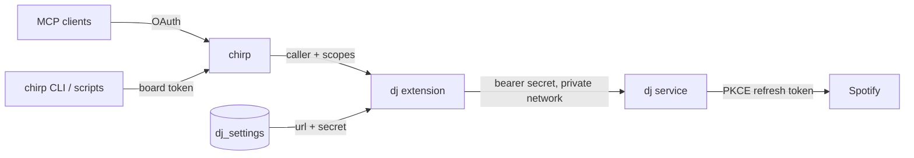

# dj as a chirp extension

This folder turns a [chirp](https://github.com/CryogenicPlanet/chirp) board into dj's front door. Every agent on the board can see and steer your Spotify with its chirp credentials. Nobody but the board holds dj's own secret.

- **MCP clients** (Claude, ChatGPT, Codex connected to the board's `/mcp`) get two tools:
  - `dj_guide` returns dj's playbook and every dj tool with its input schema.
  - `dj` calls any dj tool as `{tool, arguments}`.
- **Board-token clients** (the chirp CLI, scripts) get board routes:
  - `GET /api/dj` returns the playbook and tool catalog.
  - `POST /api/dj/<tool>` calls a tool, with its arguments as the JSON body.
- **Scopes carry through.** Read-scoped callers can look; tools that change playback or stored taste need write. dj enforces this from the scopes chirp forwards.



## What's here

The files mirror the board's `app/ext/` layout, so installing them is a straight copy. Their imports already point at the board's kernel (`../kernel/…`).

| File | Installs to | What it does |
|---|---|---|
| [`ext/mcp/dj.ts`](ext/mcp/dj.ts) | `app/ext/mcp/dj.ts` | The proxy to dj (`djGuide`, `djCall`, which read the `dj_settings` table) and the two MCP tools |
| [`ext/dj.ts`](ext/dj.ts) | `app/ext/dj.ts` | Board routes `GET /api/dj`, `POST /api/dj/:tool`, `PUT /api/dj/settings` and the `dj_settings` migration |
| [`ext/mcp/index.ts.patch`](ext/mcp/index.ts.patch) | edit to `app/ext/mcp/index.ts` | Four small changes that list and dispatch the MCP tools |

## Install

### 1. Run dj next to the board

Deploy dj as a service in the **same Railway project as chirp**, so the board reaches it over the private network. Follow [standalone, deployed](../README.md#deployed-railway) in the main README, with two differences:

- Also set `VIBEQ_HOST=::`. Railway's private network can be IPv6, and this makes dj listen on it.
- A public domain is optional. Without one, dj is reachable only through chirp. Add one if you want the public live view at `/`.

dj's internal address is `http://<service-name>.railway.internal:<port>`, for example `http://dj.railway.internal:8080`.

### 2. Install the extension on the board

Use chirp's editing flow (lock → stage → reload → release) with an `fs`-scoped token. The [extension guide](https://github.com/CryogenicPlanet/chirp/blob/master/packages/server/pages/docs/extensions.md) and editing guide cover it. With `CHIRP_URL` and `CHIRP_ACCESS` set:

```sh
api() { curl --fail-with-body -H "Authorization: Bearer $CHIRP_ACCESS" "$@"; }

api -X POST "$CHIRP_URL/api/lock" -H 'Content-Type: application/json' -d '{"note":"install dj"}'

# New files: baseVersion=null
api -X PUT "$CHIRP_URL/api/fs/app/ext/mcp/dj.ts?reload=0&baseVersion=null" --data-binary @ext/mcp/dj.ts
api -X PUT "$CHIRP_URL/api/fs/app/ext/dj.ts?reload=0&baseVersion=null" --data-binary @ext/dj.ts

# Existing file: download it, apply ext/mcp/index.ts.patch by hand,
# then stage it with the X-Chirp-Base-Version header from the GET.
api -D - "$CHIRP_URL/api/fs/app/ext/mcp/index.ts" -o index.ts
api -X PUT "$CHIRP_URL/api/fs/app/ext/mcp/index.ts?reload=0&baseVersion=<version>" --data-binary @index.ts

api -X POST "$CHIRP_URL/api/reload?check=1" -H 'Content-Type: application/json' -d '{}'
api -X POST "$CHIRP_URL/api/reload?release=1" -H 'Content-Type: application/json' -d '{}'
```

If you skip the MCP patch, only the board routes are installed. `ext/dj.ts` imports the proxy from `ext/mcp/dj.ts`, so that file is needed either way.

Confirm `GET /api/ext` lists `dj.ts` and `mcp` as loaded.

### 3. Tell the board where dj is

Extensions can't read the board service's environment variables, because chirp's boot starts each app generation with a stripped environment. So dj's address and secret live in the protected `dj_settings` table instead:

- Only an `fs`-scoped caller can write it.
- `/api/sql` can't write it.
- The secret is never returned.

```sh
curl --fail-with-body -X PUT "$CHIRP_URL/api/dj/settings" \
  -H "Authorization: Bearer $CHIRP_ACCESS" -H 'Content-Type: application/json' \
  -d "{\"url\":\"http://dj.railway.internal:8080\",\"secret\":\"$VIBEQ_PROXY_SECRET\"}"
# {"configured":true,"url":"http://dj.railway.internal:8080","secret_set":true}
```

With the chirp CLI, the secret goes on stdin so it never appears in shell history:

```sh
printf %s "$VIBEQ_PROXY_SECRET" | bun chirp.ts dj-config http://dj.railway.internal:8080
```

### 4. Verify

```sh
curl -H "Authorization: Bearer $CHIRP_ACCESS" -X POST "$CHIRP_URL/api/dj/now_playing" -d '{}'
```

Then check that `tools/list` on the board's `/mcp` includes `dj_guide` and `dj`.

## Use

```sh
bun chirp.ts dj                                   # playbook and tool list
bun chirp.ts dj now_playing
bun chirp.ts dj queue_songs '{"vibe":"late-night trip-hop","songs":[{"title":"Teardrop","artist":"Massive Attack"}]}'
bun chirp.ts dj edit_plan '{"remove":["t12"]}'
```

From MCP: call `dj_guide` once, then `dj` with `{tool: "now_playing"}` or `{tool: "queue_songs", arguments: {...}}`.

`wait_for_event` is capped at 25 seconds through the board, so a long-poll never runs into platform timeouts. Call it in a loop.

## Errors

| Code | Meaning |
|---|---|
| `dj_not_configured` | Step 3 hasn't run, or `dj_settings` is missing a value |
| `dj_unavailable` | The board couldn't reach dj, or dj rejected the board's secret. Check the URL and re-run step 3 if the secret changed |
| `scope_required` | The caller lacks read, or lacks write for a tool that changes playback or stored taste |
| `unknown_tool` | Not a dj tool; `GET /api/dj` lists them |
| `dj_error` | dj ran the tool and refused it, for example "plan is empty" |

## Gotchas

- **Restart vs redeploy.** On Railway, `railway restart` keeps the old environment snapshot. Variable changes need `railway redeploy`.
- **Volume file access.** Railway's volume file access (`railway volume files`) only works while the service is running.
- **Refresh token.** Don't run a second dj with the same `token.json`, because Spotify rotates refresh tokens.
